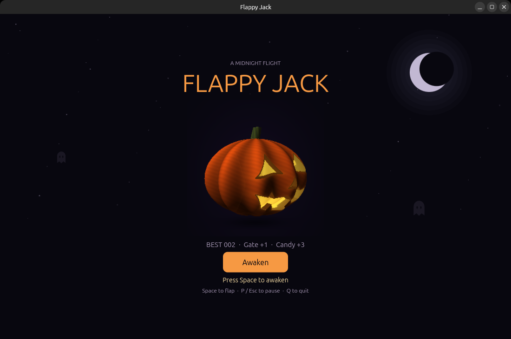
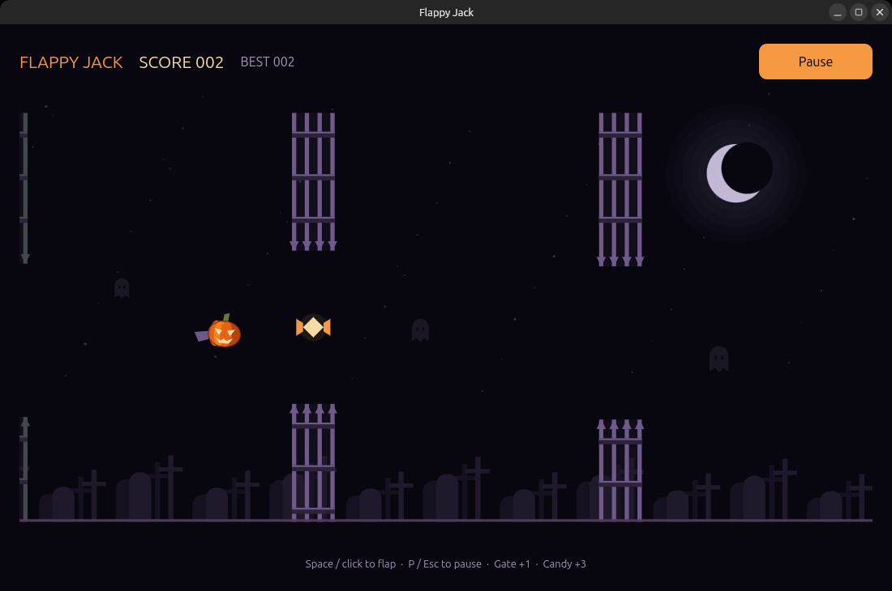

# Flappy Jack

A Halloween-themed desktop game built with [Freya](https://freyaui.dev/) and Rust. Fly a pumpkin through cemetery gates, collect candy, and beat your best score.

A fork of [aspnxdd/flappy-jack-ratatui](https://github.com/aspnxdd/flappy-jack-ratatui).





## Run

With Rust and Freya's system dependencies installed:

```sh
cargo run --release
```

## Controls

- **Space** to start, flap, or retry
- **Click** the playfield to flap
- **P / Escape** to pause or resume
- **Q** to quit

Gates give **+1**, candy gives **+3**. Your best score is saved locally.
